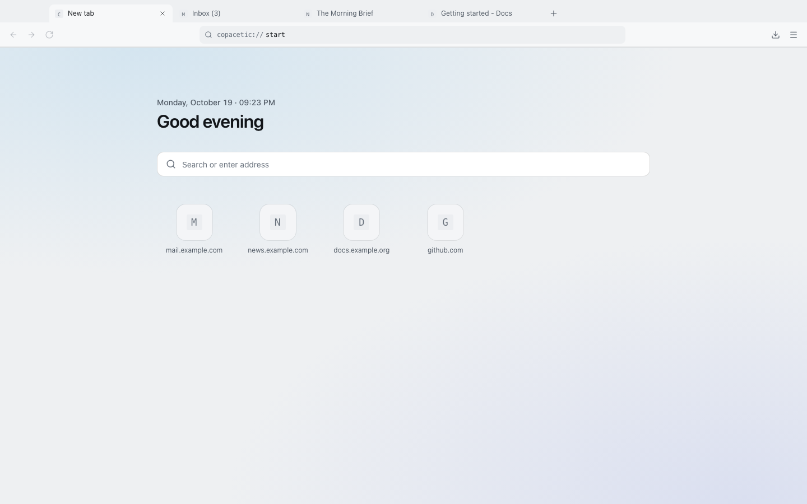
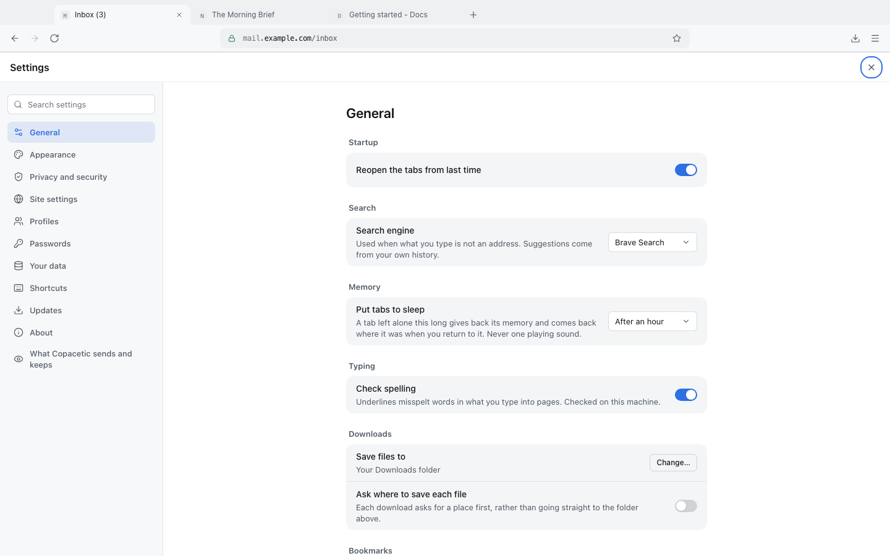

# Copacetic

**A desktop browser that tells you the truth about the page you are on.**

[](https://github.com/ryjord/Copacetic/actions/workflows/ci.yml)
[](https://github.com/ryjord/Copacetic/releases/latest)
[](https://github.com/ryjord/Copacetic/releases)
[](LICENSE)


<picture>
  <source media="(prefers-color-scheme: dark)" srcset="docs/screenshots/start-dark.png">
  
</picture>

Copacetic renders pages with Chromium, through Electron. It is a browser
_interface_, not a browser _engine_: rendering, networking and sandboxing belong
to Chromium. What Copacetic adds is everything you touch - the tab strip, the
address bar, the prompts, the panels - and a set of decisions about what a
browser should and should not do on your behalf.

**[Download for macOS, Windows or Linux](https://github.com/ryjord/Copacetic/releases/latest)** ·
[What changed](CHANGELOG.md) · [Report a security issue](SECURITY.md)

---

## Contents

- [Principles](#principles)
- [Features](#features)
- [Install](#install)
- [Security model](#security-model)
- [What it does not do](#what-it-does-not-do)
- [Performance](#performance)
- [Architecture](#architecture)
- [Development](#development)
- [Keyboard shortcuts](#keyboard-shortcuts)
- [Where your data lives](#where-your-data-lives)
- [Licence](#licence)

## Principles

**Colour only ever means state.** The interface is quiet and near-monochrome.
Where colour appears it is reporting something: the item you have selected, a
connection that is genuinely encrypted, a Hush tab, a certificate about to
expire. Nothing is coloured for decoration, so the coloured thing is always the
thing worth looking at.

**Privacy you can check, not take on trust.** Settings has a page that lists
every request Copacetic makes for itself and everything it keeps. Pages run no
script of Copacetic's beyond three that are named there, and an extension runs
only what you added it to run. Blocking counts are real
counts. Where something cannot be done, the interface says so rather than
implying it was.

**Local first.** Suggestions, spellcheck, blocking and reader view run on this
machine. There are no accounts and no telemetry.

## Features

### Reading the page honestly

- **Addresses you can actually read.** The address bar renders the URL as
  structure, with the registrable domain at full contrast and everything else
  dimmed, so `paypal.com.attacker.net/login` reads as **attacker.net**. The
  domain comes from the full Public Suffix List, so `user.github.io` and
  `example.pvt.k12.ma.us` are read correctly rather than approximated.
- **A connection panel that reports, not reassures.** The real scheme, the
  host, the measured load time, how many requests were blocked, and who issued
  the certificate and when it expires.
- **A warning when something is reading your connection.** If a certificate
  chains to a root installed on this machine rather than one your system
  shipped with - a company proxy, antivirus, a debugging tool - the panel says
  so. Mainstream browsers show the same padlock either way.
- **Every host a page contacted, not just the blocked ones**, with request
  counts and the rule or hostname that stopped each blocked one. The list can
  be saved as a **page report**, a JSON file anyone can read and check.

### Privacy

- **Ad and tracker blocking that never phones home.** EasyList, EasyPrivacy and
  the EasyList Cookie List ship inside the app, 165,663 rules in all, with a
  curated list of 122 tracking domains underneath as a floor. Nothing fetches
  them on a timer, because a periodic request from your machine is the shape of
  the thing being blocked; they update with a release, or when you ask.
- **Cookie banners hidden**, without accepting or refusing anything on your
  behalf, and without running a script in the page.
- **Tracking parameters taken off links** (`utm_`, `fbclid`, `gclid` and
  others) before the page is requested, and off Copy link address.
- **Third-party cookies blocked**, except on sites whose trackers you allowed.
  HTTPS-first upgrades every page, encrypted DNS is a choice in Settings, and
  WebRTC is limited so a page cannot learn your local address.
- **A user agent no different from Chrome's.** Electron and Copacetic are left
  out of it, the version is reduced to its major number as Chrome's own is, and
  the high-entropy client hints a site can ask for are never answered.
- **Hush tabs.** `Cmd/Ctrl+Shift+N` opens a tab your machine forgets: no
  history, cookies, cache or icons written to disk. It is not called private or
  incognito, because it does not make you anonymous, and the tab says so.
- **Open rules.** Set a site to always open in Hush, or always in one tab group,
  and following a link or typing its address takes it there.
- **Suggestions from your own history and bookmarks only.** No keystroke is
  sent anywhere to fetch remote suggestions.

### Working with tabs

- **Split view.** Two tabs side by side, with a divider you can drag or step
  with the arrow keys.
- **Saved sessions.** Keep a window's tabs by name and open them again later in
  a window of their own.
- **Tab groups**, each optionally keeping its own cookies and logins, and
  **profiles**, each with its own history, bookmarks, passwords, settings and
  wallpaper.
- **Windows, pinned tabs and sleeping tabs.** Tabs left alone give back their
  memory and come back where they were. Each tab's tooltip says how much memory
  its page is using.
- **Tab search** on `Cmd/Ctrl+Shift+A`, and a **command palette** on
  `Cmd/Ctrl+K` that reaches every command, bookmark, page of history and
  setting, and teaches each command's shortcut.
- **Reopen what you closed.** `Cmd/Ctrl+Shift+T` brings back the last tab, or a
  whole group as a group, pinned if it was, from any window, and Recently
  closed lists the rest in the main menu and beside the new tab button.
- **Back still works after a restart.** Each tab keeps where Back and Forward go,
  as addresses and titles only.
- **Sign-in pop-ups that work.** "Sign in with Google" and its like open as a
  tab that stays linked to the page that opened it, never as a window.

### Extensions (beta)

- **From the Chrome Web Store**, checked against the store's own signature
  before anything is unpacked, or from a folder while you build one. Settings
  says what each could do, in the words Chrome's warnings use, before it is
  added.
- **Toolbar buttons and popups**, extension items in the page menu, and the
  parts of Chrome's extension API Electron leaves out, supplied by Copacetic
  itself: tabs and their events, windows, navigation events, notifications.
- **Per profile, and never in Hush.** An extension sees a page's address only
  with leave to, as in Chrome. Dark Reader, Bitwarden and uBlock Origin Lite
  run.
- **Ad blockers block.** Electron does not apply an extension's
  declarativeNetRequest rules, so Copacetic matches them itself, as Chrome
  does: the lists an extension ships, the rules it adds as it runs, and the
  count of what it blocked on its toolbar button.

### Reading and saving

- **Reader view** on `Cmd/Ctrl+Alt+R`. The article is read through DevTools
  rather than a script in the page, and rebuilt from a short list of tags so
  none of the page's markup reaches the interface. It has its own text size,
  typeface and line length, and shows the article's images.
- **Translation** of an article in reader view, on this machine, with models
  downloaded from Mozilla the first time a language is used and checked
  against the hash Mozilla publishes.
- **A picture of the whole page**, saved as a PNG, plus Save page as, View
  source, printing, PDFs in the built-in viewer, and find in page with match
  counts.
- **Zoom remembered per site**, with a chip in the address bar that shows when
  a page is off your default and resets it in one click.

### Your data

- **Import** bookmarks, folders and recent history from Chrome, Brave, Edge,
  Vivaldi, Chromium, Arc and Firefox, read from a copy of their files on this
  machine, and Safari's bookmarks from the file it exports. Passwords come in
  from the CSV file each browser exports itself. **Export** bookmarks in the
  format every browser reads and history as plain JSON.
- **Passwords** kept in a vault sealed with your system keychain, generated to
  the length and character set you choose, and filled only when you ask: a key
  in the address bar fills a saved one in one click. They can be searched,
  sorted, edited and copied, and a copied password is cleared from the
  clipboard after 30 seconds, or as soon as the vault locks.
- **History, bookmarks and downloads you can filter and sort**, with a tick per
  row to open, delete or remove many at once, and **Undo** for eight seconds
  after removing anything that can be put back.
- **Bookmarks in reach.** A button beside the address bar opens every folder as
  a menu, the star opens a sheet to name a bookmark and choose its folder, and
  the bookmarks bar keeps what does not fit behind ».
- **Site settings in one place**: permissions, zoom, tracker exceptions and open
  rules for every site, with a default per permission and the option to decide
  for a site before it asks.
- **Forget a site** removes its history, icons, settings, certificates and
  cookies in one step. **Clear browsing data** lets you choose what goes.
- **Downloads with real controls**: pause, resume, retry, choose where files go,
  and anything that runs when opened is held until you say to keep it.
  Filenames are cleaned of path tricks and right-to-left overrides.

### Also

Settings in four groups, for the browser, privacy, you and Copacetic itself,
with a search that lands on the setting rather than its page. A start page you
assemble from widgets, over one of six backgrounds or your own photo. Light or
dark, an accent colour, text size and density, and which buttons the toolbar
shows. Your own search engines, reached by a keyword. A choice of what opens at
startup and of how long history is kept. A picture or initials for each
profile. Shortcuts you can move to other keys, an offer to reopen your tabs
after a crash, native context menus and a full application menu, and the
system's own window controls on Windows and Linux.

<picture>
  <source media="(prefers-color-scheme: dark)" srcset="docs/screenshots/settings-dark.png">
  
</picture>

## Install

Installers for every platform are on the
[latest release](https://github.com/ryjord/Copacetic/releases/latest). Betas are
published as prereleases on the [releases page](https://github.com/ryjord/Copacetic/releases).
A beta is offered newer betas as well as releases; a finished build is offered
releases only, unless Settings is set to offer betas too.

| Platform        | File                                      | Updates                                       |
| --------------- | ----------------------------------------- | --------------------------------------------- |
| macOS           | `Copacetic-<version>-arm64.dmg` or `.dmg` | Downloads the installer, checks it, opens it  |
| Windows         | `Copacetic-Setup-<version>.exe`           | Downloads in the background, installs on quit |
| Linux, AppImage | `Copacetic-<version>.AppImage`            | Downloads in the background, installs on quit |
| Debian, Ubuntu  | `copacetic_<version>_amd64.deb` or apt    | Through `apt upgrade`                         |

Supported versions are 1.4 and later. Older releases have been withdrawn.

### macOS

The builds are not code-signed, so Gatekeeper refuses the app on first launch
rather than just warning. Right-click it and choose Open, or clear the
quarantine flag:

```bash
xattr -cr /Applications/Copacetic.app
```

Updating in place needs a signed app, so on macOS Download and open saves the
installer to Downloads, checks it against the SHA-512 the release publishes, and
opens it for you to drag into Applications. Not signing is a cost decision
rather than an oversight, and Settings says so.

### Windows

Expect a SmartScreen prompt on first launch, for the same reason. Choose More
info, then Run anyway.

### Debian and Ubuntu

Add the repository once and Copacetic installs and updates like any other
package:

```bash
sudo curl -fsSL https://pub-4eb7b3b013b1424caf0cfa2c570bcc61.r2.dev/copacetic-archive-keyring.gpg \
  -o /usr/share/keyrings/copacetic-archive-keyring.gpg
sudo curl -fsSL https://pub-4eb7b3b013b1424caf0cfa2c570bcc61.r2.dev/copacetic.sources \
  -o /etc/apt/sources.list.d/copacetic.sources
sudo apt update && sudo apt install copacetic
```

You are trusting a key fetched over the network, so check it is the one that
signs these packages first:

```bash
gpg --show-keys --with-colons /usr/share/keyrings/copacetic-archive-keyring.gpg | awk -F: '/^fpr/{print $10; exit}'
# FAF1C904013853AA76EA0E06D729BEB377078736
```

`Signed-By` binds the key to this one repository, so it cannot vouch for any
other package on your system. The `.deb` registers the same source itself, so
this is only needed on a machine that has never had Copacetic. Betas are not
published to the repository; they are downloaded from the releases page.

### Checking a download

Nothing in an unsigned installer says who made it, but whether the file is the
one this repository built can be answered for free. Every release is attested by
GitHub, naming the commit and workflow run it came from:

```bash
gh attestation verify Copacetic-2.0.0-arm64.dmg --repo ryjord/Copacetic
```

A file tampered with in transit, or served from anywhere but this repository,
fails the check.

### Making it the default browser

Settings has a control that says what your platform allows. macOS and Linux can
be asked directly; Windows 10 and 11 do not let an application make itself the
default, so there the control opens the screen where you choose. Nothing
registers itself at startup.

## Security model

Copacetic renders hostile content by design, and the measures below follow from
that. To report something that gets past them, see [SECURITY.md](SECURITY.md).

| Concern                               | What Copacetic does                                                                                                                                                                                             |
| ------------------------------------- | --------------------------------------------------------------------------------------------------------------------------------------------------------------------------------------------------------------- |
| Page code reaching the app            | Tabs run with `sandbox: true`, `contextIsolation: true`, no `nodeIntegration` and **no preload script**                                                                                                         |
| Renderer compromise reaching the OS   | The interface's renderer is sandboxed too, and every IPC handler validates its sender and the shape of what it sent                                                                                             |
| Page data reaching the interface      | Web content lives in its own session partitions, separate from the session that runs the interface                                                                                                              |
| The interface being navigated away    | Navigation is refused for anything that is not the app's own document, so the bridge is never handed to a remote origin                                                                                         |
| Popups imitating browser chrome       | Every new window is denied. Pages get a tab, never a window                                                                                                                                                     |
| Dangerous URL schemes                 | `javascript:`, `data:`, `blob:`, `vbscript:` and `filesystem:` are refused for top-level navigation, from the address bar and from page code alike, and never handed to another application                     |
| `<webview>` injection                 | Disabled in `webPreferences` and refused in `will-attach-webview`, so the guarantee does not rest on one options object                                                                                         |
| Over-broad permissions                | Device access, ambient signals and cross-site storage are denied without a prompt. Only permissions a person can meaningfully evaluate are asked about                                                          |
| Requests made from the interface      | Icons are fetched by the main process in the page's own session and handed over as data URLs, so the interface never makes a network request and a page cannot name a private-network host to have it requested |
| Cross-site scripting in the interface | A strict Content Security Policy with `default-src 'none'`                                                                                                                                                      |
| Locally trusted certificates          | A development server's certificate is accepted for `localhost` and loopback only, and the badge says it was not checked                                                                                         |
| Malicious download filenames          | Path components, control characters and bidirectional overrides are stripped before a file is written                                                                                                           |
| Tampering with the packaged app       | Electron's fuses are set: no `RunAsNode`, no `NODE_OPTIONS`, no inspector flags, ASAR integrity validated, and the app loads only from its archive                                                              |

Three small scripts are the only ones Copacetic puts in a page, and the
transparency page names each of them. One fills in the `window.chrome` object
that real Chrome has and Electron leaves empty, with three placeholder members
and nothing of the browser's, because some sign-in pages refuse a browser
without it. Fill password runs once, when you choose it. And a page left in full
screen when you switch to another tab is asked to leave it, with one call that
reads nothing.

An extension you add runs its own code, in the pages it asks for, as it would in
Chrome. Once one is added, Copacetic gives every service worker in that profile
a script of its own, which supplies the missing parts of the extension API to an
extension and does nothing in a website's worker. None of it reaches Hush.

## What it does not do

- **No accounts, sync or cloud.** Everything lives on this machine, and Settings
  writes it back out in open formats, so that is a statement you can check. The
  only scheduled request is the update check, which reads a version number from
  GitHub and can be turned off.
- **Extensions are a beta.** An ad blocker's report of which rules matched is
  always empty, an extension's page opened in a tab lacks the parts of the API Copacetic supplies, and some
  extensions will not work. On Linux, started with `--no-sandbox`, an
  extension cannot see tabs or change its toolbar button: Electron gives an
  extension's worker Copacetic's script only in a sandboxed process.
- **No DRM.** Widevine is not bundled, so Netflix and Spotify will not play.
- **What Electron cannot do.** Cookies, site data and the cache clear for all
  time, not for an hour or a day; find in page has no whole-word option; on
  macOS spelling follows the languages in System Settings.
- **Left out on purpose.** A restored tab does not keep its scroll position,
  since the page state that holds it also holds what was typed into forms.
  HTTPS-first upgrades the page, not the frames inside it, as Chrome does. A
  bookmark for a site never visited shows its first letter rather than fetch an
  icon from the site unasked.
- **English only.** Every word is in one catalogue, ready for a second language
  once someone fluent has checked it.
- **Translation in reader view only.** An article is translated on this
  machine; a whole page, with its layout, is not.
- **Certificate inspection is Chromium's.** The badge reports the certificate
  Chromium accepted; it does no chain analysis of its own.
- **Not code-signed, and not audited.** A personal project built to a high
  standard, not a browser that has been through a security review. Without a
  certificate, updates on Windows and as an AppImage carry no signature, cookies
  are not sealed with a key tied to the app, and macOS installs updates by hand.

## Performance

Measured, not claimed: `npm run measure` launches the built app on a throwaway
profile five times and reports the median. The figures below are from one
machine, so run the script for your own.

|                                       |                         |
| ------------------------------------- | ----------------------- |
| Start to a visible window             | 483 ms                  |
| Start to a window that responds       | 658 ms                  |
| Blocking engine, loaded on launch     | 5 ms, for 165,663 rules |
| Blocking engine, built from the lists | 305 ms                  |
| Memory, just the start page           | 784 MB                  |
| Memory, five pages open               | 1,428 MB, 129 MB a page |

`Apple M4 Pro, 14 cores, 48 GB RAM, Electron 43.8.1, macOS arm64, the production build of 2.0.0.`

The engine is compiled when the app is packaged and read back on launch, which
is why loading it takes 5 ms rather than the 305 ms building it would. Memory
is every process the app runs added together, because that is what the machine
gives up; most of it is Chromium, and most of each page's cost is its own
renderer process, the price of pages not sharing one.

## Architecture

Page content belongs to the **main process**, as one `WebContentsView` per tab.
The renderer is the interface alone: it never touches page content and holds no
browser state of its own, only what the main process pushes to it.

```
electron/
  main/
    app/          lifecycle, windows, profiles, typed and validated IPC
    tabs/         one view per tab, navigation, split view, sleep, find
    security/     session hardening, blocking, HTTPS-first, certificates
    data/         SQLite database, settings, sessions, downloads, export
    import/       reading other browsers' profiles from a copy
    menus/        application and context menus, the shortcut table
    vault/        the password vault and its keychain key
    extensions/   installing, loading and the chrome.* API Electron lacks
    window/       the window, its appearance and overlay regions
    workflows/    commands that span several of the above
  preload/        the only bridge, built from one channel table
  shared/         types and logic both sides use, grouped by subject,
                  and the English string catalogue in i18n/
src/
  components/     ui/, shell/ and views/<feature>/
  lib/ store/     the bridge client, state, and shared helpers
smoke/            tests that launch the built app in real Electron
tests/            unit tests, mirroring the source tree
```

Two consequences of `WebContentsView` shape the interface. A native view
always paints above the renderer's HTML, so anything that must cover a page -
the panels, the palette, the reader - hides the view instead of floating over
it. And the renderer measures its own layout and reports the content rectangle,
so the main process places each page exactly into the space the interface left
for it.

## Development

Requires **Node 24**. The data layer uses `node:sqlite`, which the test suite
loads directly; Electron 43 runs Node 24 itself.

```bash
npm install
npm run dev        # Next dev server, main process watch and Electron
npm run build      # the production build
npm start          # run the production build
npm run package    # installers for this platform, into release/
```

### Checks

```bash
npm run verify          # format, lint, typecheck (five projects) and unit tests
npm run smoke           # launches the built app and checks it in real Electron
npm run check:packaged  # fuses, licences and the updater, against a packaged build
```

Judge `verify` by its exit code. The unit tests cover the parts where being
wrong is expensive - address resolution, the registrable domain, blocking,
filenames, the vault, the database - and the smoke suite covers what only a
running browser can prove, such as a page receiving no bridge and a blocked
request actually being cancelled. CI runs all three on macOS, Windows and Linux.

Releases follow [VERSIONING.md](VERSIONING.md): work lands on a branch, and
pushing a tag is what builds and publishes installers.

## Keyboard shortcuts

Every menu shortcut can be moved to other keys in Settings.

|                                    |                                     |
| ---------------------------------- | ----------------------------------- |
| `Cmd/Ctrl+T` / `Cmd/Ctrl+W`        | New tab / close tab                 |
| `Cmd/Ctrl+Shift+N`                 | New Hush tab                        |
| `Cmd/Ctrl+Shift+T`                 | Reopen the last closed tab          |
| `Cmd/Ctrl+N`                       | New window                          |
| `Cmd/Ctrl+L`                       | Focus the address bar               |
| `Cmd/Ctrl+K`                       | Command palette                     |
| `Cmd/Ctrl+Shift+A`                 | Search open tabs                    |
| `Cmd/Ctrl+Shift+E`                 | Split view, or leave it             |
| `Cmd/Ctrl+Alt+R`                   | Reader view                         |
| `Cmd/Ctrl+F` / `Cmd/Ctrl+G`        | Find on page / find next            |
| `Cmd/Ctrl+R` / `Cmd/Ctrl+Shift+R`  | Reload / reload ignoring cache      |
| `Cmd/Ctrl+[` / `Cmd/Ctrl+]`        | Back / forward                      |
| `Cmd/Ctrl+D`                       | Bookmark this page                  |
| `Cmd/Ctrl+S` / `Cmd/Ctrl+Shift+S`  | Save page / save a picture of it    |
| `Cmd/Ctrl+1` to `8` / `Cmd/Ctrl+9` | Select a tab by position / last tab |
| `Cmd/Ctrl+Y` / `Cmd/Ctrl+Shift+J`  | History / downloads                 |
| `Cmd/Ctrl+ +` / `-` / `0`          | Zoom in, out, reset                 |
| `Cmd/Ctrl+,`                       | Settings                            |

## Where your data lives

In the system's application data folder:

- macOS: `~/Library/Application Support/Copacetic`
- Linux: `~/.config/Copacetic`
- Windows: `%APPDATA%\Copacetic`

History, bookmarks and their folders, site icons, downloads, saved sessions and
per-site settings are in one SQLite database, `copacetic.db`. Settings, the open
session and the password vault are JSON files beside it, written atomically. A
file that cannot be read is set aside rather than blocking startup. Each extra
profile keeps the same set in `profiles/<id>/`.

**Upgrading from 1.x is one way.** The first 2.0 launch moves the old stores
into the database, and 1.x cannot read it. Copacetic copies what it changes into
`before-2.0/` first; to go back, quit, copy those files back and delete
`copacetic.db`.

## Licence

Copacetic is MIT licensed; see [LICENSE](LICENSE).

It also redistributes material that is not its to license. The EasyList,
EasyPrivacy and EasyList Cookie List filter lists ship whole under their own
terms, GPLv3 or CC BY-SA 3.0 at the recipient's election, and every package the
app ships is listed with its licence in About. [NOTICE](NOTICE) records what
they are, where they came from and under what terms, which matters if you fork
Copacetic and matters more if you sell it.
